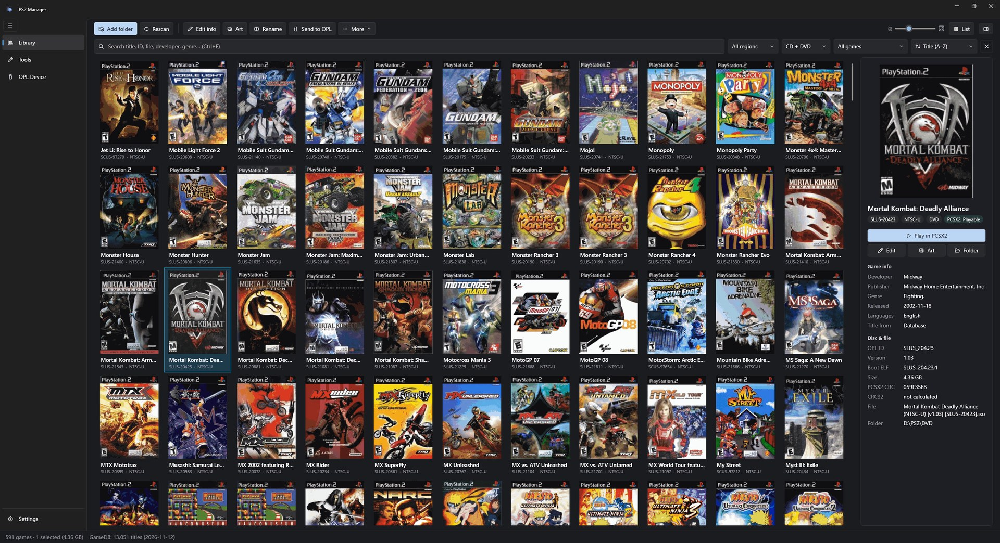

<p align="center">
  
</p>

<h1 align="center">PS2 Manager</h1>

A Windows tool for managing PS2 disc images, with support for Open PS2 Loader (OPL) and PCSX2.



## Features

**Library**
* Scan folders of `.iso` / `.bin` / `.img` files; each game is identified from the disc itself, not the file name
* Cover or list view, with search, filters (region, CD/DVD, missing cover…) and sorting
* Title, genre, developer, release date and more from GameDB-PS2
* Quick rescans that only read new or changed files

**Game info and art**
* Edit game info, including the OPL fields (players, video mode, aspect ratio, compatibility modes)
* Your edits are kept separately, so updating the database never overwrites them
* Download covers and all OPL art types (back cover, spine, disc icon, logo, screenshots…), one game or in bulk

**Rename and organize**
* Rename files from game info using templates like `{TITLE} [{GAME_ID}]`
* Move games into their own folders, or flatten them into one
* Every change is previewed first and can be undone

**OPL**
* Send games to a USB drive, internal HDD or network share, with CFG and art included
* CD and DVD games go to the right folder automatically
* See what's on the device, and fix missing CFG files, missing art or games in the wrong folder

**PCSX2**
* Launch games in PCSX2 using your existing PCSX2 settings
* PCSX2 compatibility rating for each game
* Share your covers and library folders with PCSX2

**Tools**
* Find duplicate games
* CRC32 checksums for comparing with Redump
* Export the library to Excel, CSV or text

## Download

Get the latest version from [Releases](https://github.com/pearlxcore/PS2-Manager/releases). Unzip and run `PS2 Manager.exe` (Windows 10/11, 64-bit).

Upgrading from 1.x: use **Tools → Import manifest from the old version** to keep your library and covers.

## Notes

* Sending `.bin` images to OPL isn't supported for now.
* Games over 4 GB need an exFAT-formatted OPL drive.
* App data is stored in `%LocalAppData%\PS2Manager`. Set `PS2MANAGER_DATA` to use a different folder.

## Building

Requires the [.NET 10 SDK](https://dotnet.microsoft.com/download/dotnet/10.0).

```
dotnet build "PS2 Manager.slnx"
dotnet test PS2Manager.Tests
pwsh tools/publish.ps1
```

## Credits

[GameDB-PS2](https://github.com/niemasd/GameDB-PS2) ·
[xlenore/ps2-covers](https://github.com/xlenore/ps2-covers) ·
[OPL art database](https://github.com/Luden02/psx-ps2-opl-art-database) ·
[PCSX2](https://github.com/PCSX2/pcsx2) ·
[DiscUtils](https://github.com/DiscUtils/DiscUtils) ·
[WPF-UI](https://github.com/lepoco/wpfui)

Not affiliated with Sony or PCSX2.
